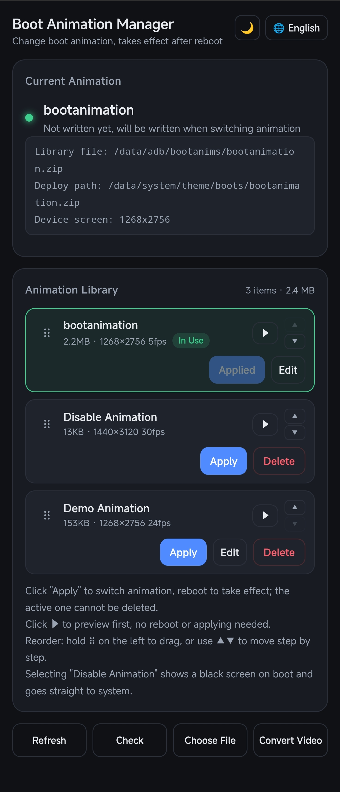

# QIMU (启幕)

**Documentation Languages:**
- [English (Default)](README.md)
- [Bahasa Indonesia](README_ID.md)
- [简体中文](README_CN.md)

---

A boot animation manager for HyperOS, compatible with KernelSU, SukiSU, APatch, and Magisk. Features a complete multilingual interface (English, Bahasa Indonesia, Simplified Chinese) to switch animations, import packages, delete animations, convert videos into boot animations, rename items, adjust screen resolutions, or disable boot animations entirely.

When loading boot animations, HyperOS checks `/data/system/theme/boots/bootanimation.zip` first, prioritizing it over `/system/media` and `/product/media`. Consequently, this module writes directly to this theme path without modifying system partitions. When the module is disabled or uninstalled, the system automatically reverts to the factory default boot animation on the next reboot.

<p align="center">
  
</p>

## Features

- **Switch Animations**: Click "Apply" in the WebUI; changes take effect after rebooting.
- **Import Custom Animations**: Place zip archives in the "Download" folder, click "Choose File", and browse to the file location to import.
- **Custom Ordering**: Hold and drag the ⠿ handle on the left, or use the ▲▼ buttons to move items step-by-step; order changes are saved immediately upon release.
- **Disable Boot Animation**: Select "Disable Animation" to show a clean black screen on boot and proceed straight to the system.
- **Video to Animation**: Convert videos on your device (MP4/MOV/MKV/WEBM) directly into boot animation packages and import them, processed entirely locally on the phone without needing a PC.
- **Edit Animations**: Open the "Edit" dialog on any animation to rename it or adjust its resolution (fit to screen, swap W/H, or enter custom width and height).
- **Preview Animations**: Click the ▶ button in any row to preview the animation in a looping popup dialog at its actual frame rate, resolution, parts, and loop count—no reboot or prior application required.
- **Automatic Resolution Adaptation**: Animations are automatically adapted to your device's screen dimensions upon deployment to eliminate black borders and prevent cropping; inverted orientations are automatically corrected, while manual resolution overrides are strictly respected.
- **Theme Support**: Seamlessly follows system dark/light mode, or can be pinned manually to Light or Dark mode.
- **Multilingual Interface (i18n)**: Full support for English (default), Bahasa Indonesia, and Simplified Chinese, switchable instantly without reloading.

## Installation

1. Flash the latest zip package from [Releases](https://github.com/LAmireuxP/qimu/releases) via your root manager (KernelSU / SukiSU / APatch / Magisk).
2. Reboot the device.
3. Open the module's "Action / Settings" in your root manager to launch the WebUI.
4. The module comes preloaded with "Disable Animation" and a demo animation. To use custom animations, simply import your own zip files. Future updates can be flashed directly over existing installations; your selected animation and ordering will be preserved.

During installation, a guard script (`qimu-guard.sh`) is placed in `/data/adb/post-fs-data.d/` and `/data/adb/service.d/`. These locations reside outside the module directory for a specific safety purpose: if the module is disabled or removed, the guard script cleans up the animation file on the theme path so the device safely restores its factory boot animation. The guard scripts are automatically removed when the module is uninstalled.

## Usage

1. Open the WebUI, click "Apply" on the desired animation, and reboot.
2. **Adding Custom Animations**: The zip archive must be uncompressed (**ZIP_STORED**) and contain `desc.txt` in its root directory. Click "Choose File" and browse to your file to import it. If the format does not meet requirements, the UI will explain the validation failure.
3. **Using Videos as Boot Animations**: Click "Convert Video", select a video from your device (lists Download and Movies folders by default, or browse custom directories), and convert/import it with a single click without a computer.
4. **Renaming & Adjusting Resolution**: Click "Edit" on any animation; if the currently active animation is modified, it will be automatically redeployed.
5. **Previewing**: Click the ▶ button on the left of any animation to preview it with its genuine frame rate, dimensions, parts, and loop settings; closing the preview dialog automatically purges temporary extracted frames.
6. The currently active animation is clearly labeled with the "In Use" tag.

### Desktop Utilities

- `tools/pad_convert.py`: Converts arbitrary AOSP-format animations into compatible packages on a computer: frames are cover-scaled/cropped to target dimensions (full-screen without black borders, lossless PNG), updates the first line of `desc.txt`, and enforces uncompressed storage. Install dependencies with `pip install pillow`, then execute: `python tools/pad_convert.py source.zip target.zip name 1080x2400`.
- `tools/mp4_convert.py`: Desktop version of the built-in video-to-animation converter, yielding identical output for batch processing or precise frame rate and resolution tuning: install dependencies with `pip install imageio-ffmpeg`, then run: `python tools/mp4_convert.py video.mp4 animation.zip`.

## Supported Package Formats

QIMU supports both common boot animation package formats found online:

**① Bare Animation Package** — The standalone `bootanimation.zip` itself, where the root directory directly contains `desc.txt` along with frame folders such as `part0/`. These can be imported directly.

**② Root Module Package (KSU / Magisk)** — A module archive containing `module.prop`, `META-INF/com/google/android/update-binary`, `post-fs-data.sh`, with the animation nested inside as an internal `bootanimation.zip`. When imported, QIMU automatically extracts the nested `bootanimation.zip` without requiring manual unpacking. The extracted animation must still pass uncompressed and `desc.txt` validation checks.

How to tell them apart: Open the archive in a file manager or archive viewer—if the root directly displays `desc.txt` + `part0/`, it is type ①; if it shows `module.prop` and `META-INF`, it is type ②.

> Note: Type ② module packages can also be flashed directly as standalone modules in your root manager. Choose one method; do not install both simultaneously to avoid priority conflicts.

## Tested Devices

The following devices have been verified and tested:

- **Device:** Redmi K60 Pro (socrates)
  - **OS:** HyperOS 4.0 / Android 17 port (1440×3200, root: SukiSU)
  - **Status:** Tested
- **Device:** Redmi K30S Ultra (apollo)
  - **OS:** HyperOS 4.0 / Android 17 (1080×2400, root: APatch with FolkPatch manager)
  - **Status:** Tested
- **Device:** POCO X8 Pro (klee)
  - **OS:** HyperOS 3, Android 17 (1268×2756, root: KernelSU Next)
  - **Status:** Tested

| Device | OS | Status | Notes |
| :--- | :--- | :--- | :--- |
| **Redmi K60 Pro** (socrates) | HyperOS 4.0 / Android 17 port | Tested | 1440×3200, root: SukiSU |
| **Redmi K30S Ultra** (apollo) | HyperOS 4.0 / Android 17 | Tested | 1080×2400, root: APatch (FolkPatch) |
| **POCO X8 Pro** (klee) | HyperOS 3, Android 17 | **Tested** | 1268×2756, root: KernelSU Next |

To inspect module status via ADB:

```bash
adb shell su -c "/data/adb/modules/custom_bootanimation/bin/ctl.sh status"
```

To verify whether your ROM reads from the theme boot animation path:

```bash
adb shell su -c "strings /system/lib64/libbootanimation_preapex.so | grep theme/boots"
```

If the command produces matching output, your system supports this theme path and the module will take effect; if there is no output, this mechanism is not applicable to your ROM.

## Disclaimer

This project has only been tested on the specific configurations listed above. Situations on other ROMs and devices may vary. Modifying boot animations carries inherent system risks; proceed at your own discretion. The author assumes no liability for system anomalies or boot issues. Always take a complete backup and ensure you have recovery options (such as fastboot or custom recovery) available before flashing.

## Technical Details & CLI

### Packaging the Module

To build a flashable zip archive from source:

```bash
python tools/pack.py          # → release/qimu-<version>-<versionCode>.zip
```

The build script packages `module.prop`, shell scripts, `bin/`, `webroot/`, `animations/`, and the Magisk `META-INF` template; `tools/` and documentation files are excluded. The version number is read directly from `module.prop`.

### Technical Specifications
- **Archive Requirements**: The root must contain `desc.txt` (first line format: `width height fps`), and the entire zip must be uncompressed (ZIP_STORED). Editing `desc.txt` in standard Windows Notepad may introduce UTF-8 BOM characters that trigger a black screen on boot—QIMU automatically detects and rejects archives with BOM.
- **Part Validation**: Every part folder specified in `p` or `c` lines of `desc.txt` (e.g. `part0` in `p 1 0 part0`) must exist and contain valid frame images inside the archive.
- **Xiaomi Format Handling**: Custom Xiaomi-style `desc.txt` syntax is automatically normalized to standard Android format during import and deployment.
- **Resolution Adaptation**: Animations are resized to match physical screen resolution upon deployment, with automatic orientation detection to avoid flipped screens. Manual user overrides in the WebUI take precedence over automatic scaling.
- **Screen Dimension Cache**: Screen dimensions are cached in `state/screen.txt`. During `late_start`, the `sync` command refreshes dimensions to handle DPI changes or device swaps.
- **Storage Paths**: Library animations are stored in `/data/adb/bootanims/`, and the active animation is deployed to `/data/system/theme/boots/bootanimation.zip`.

### CLI Subcommands (`bin/ctl.sh`)

Subcommands: `list / status / info / select / fit / desc / setres / swap / rename / import / export / delete / ls / reset / order / guard / unguard / deploy / check / sync / gc`.

- `import PATH [name]`: Imports an animation, with an optional custom name as the second argument.
- `export N [path]`: Exports an original animation archive from the library to device storage (defaults to `/sdcard/Download`).
- `check`: Runs a health check across all library packages to ensure archive integrity.
- `sync`: Forces screen dimension refresh, redeploys active animation if missing, and cleans residual files.
- `gc`: Cleans up interrupted import and video conversion temporary files older than 6 hours.

### License & Assets

Licensed under the MIT License. This repository contains no commercial IP assets: "Disable Animation" consists of a single pure black frame, and the demo animation is generated cleanly via `tools/make_demo.py`.
