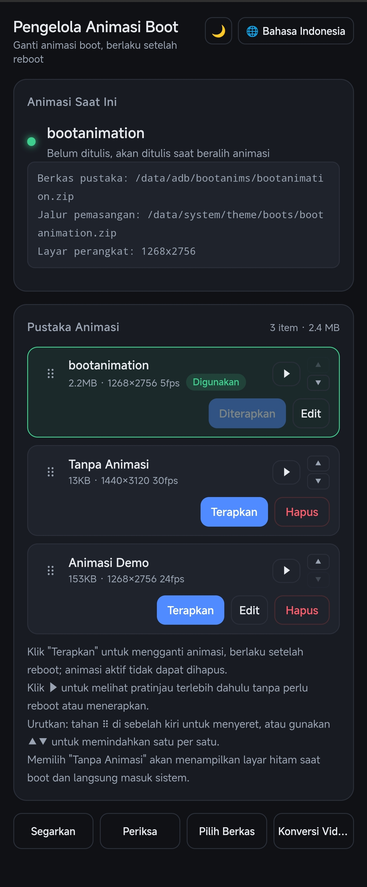

# QIMU (启幕)

**Bahasa Dokumentasi / Documentation Languages:**
- [English (Default)](README.md)
- [Bahasa Indonesia](README_ID.md)
- [简体中文](README_CN.md)

---

Pengelola animasi boot untuk HyperOS, kompatibel dengan KernelSU / SukiSU / APatch / Magisk. Dilengkapi antarmuka multibahasa (Inggris / Indonesia / Mandarin Sederhana) untuk mengganti animasi, mengimpor animasi, menghapus animasi, mengonversi video ke animasi boot, mengubah nama, menyesuaikan resolusi, atau menonaktifkan tampilan animasi boot sepenuhnya.

Saat memuat animasi boot, HyperOS memeriksa jalur `/data/system/theme/boots/bootanimation.zip` terlebih dahulu, mendahului `/system/media` dan `/product/media`. Oleh karena itu, modul ini menulis langsung ke jalur tersebut tanpa memodifikasi partisi sistem. Jika modul dinonaktifkan atau dihapus, perangkat akan otomatis kembali ke animasi bawaan pabrik pada boot berikutnya.

<p align="center">
  
</p>

## Fitur

- **Ganti Animasi**: Klik "Terapkan" di antarmuka WebUI, berlaku setelah reboot perangkat.
- **Impor Animasi Sendiri**: Letakkan berkas zip di folder "Download", klik "Pilih Berkas" dan jelajahi lokasi berkas animasi untuk mengimpor.
- **Atur Urutan**: Tahan simbol ⠿ di sebelah kiri untuk menyeret ke atas/bawah, atau gunakan tombol ▲▼ untuk memindahkan baris demi baris; urutan tersimpan otomatis saat dilepas.
- **Tanpa Animasi**: Pilih "Tanpa Animasi" untuk layar hitam saat boot dan langsung masuk ke sistem.
- **Konversi Video ke Animasi**: Video di ponsel (MP4/MOV/MKV/WEBM) dapat langsung dikonversi menjadi animasi boot dan diimpor, diselesaikan secara lokal di ponsel tanpa PC.
- **Edit Animasi**: Pada jendela "Edit", ubah nama dan sesuaikan resolusi (sesuaikan layar, tukar P/L, atau isi resolusi manual).
- **Pratinjau Animasi**: Klik tombol ▶ di sebelah kiri setiap animasi untuk memutar animasi dalam loop di jendela pratinjau, tanpa reboot dan tanpa perlu menerapkan terlebih dahulu.
- **Adaptasi Resolusi Otomatis**: Disesuaikan otomatis dengan ukuran layar ponsel saat dipasang untuk menghindari bilah hitam atau gambar terpotong; orientasi terbalik otomatis diperbaiki; animasi yang diatur manual akan dipasang sesuai pengaturan Anda.
- **Dukungan Tema**: Mengikuti tema gelap/terang sistem secara dinamis, atau dapat dikunci secara manual ke mode Terang atau Gelap.
- **Antarmuka Multibahasa (i18n)**: Mendukung bahasa Inggris (English, default), Indonesia (Bahasa Indonesia), dan Mandarin Sederhana (简体中文), dapat dialihkan secara instan.

## Pemasangan

Pasang (flash) berkas zip terbaru dari [Releases](https://github.com/LAmireuxP/qimu/releases) melalui pengelola modul Anda (KernelSU / SukiSU / APatch / Magisk), reboot, lalu buka menu modul dan klik "Action / Pengaturan" untuk masuk ke WebUI. Modul sudah menyertakan opsi bawaan "Tanpa Animasi" dan sebuah animasi demo. Jika ingin mengganti animasi, cukup impor animasi Anda sendiri. Pembaruan versi modul dapat langsung di-flash di atas versi sebelumnya; animasi dan urutan yang telah Anda atur akan tetap tersimpan.

Selama pemasangan, skrip `qimu-guard.sh` akan ditempatkan di `/data/adb/post-fs-data.d/` dan `/data/adb/service.d/`. Kedua direktori ini berada di luar modul dengan satu tujuan utama: jika modul dinonaktifkan atau dihapus, skrip ini akan membersihkan berkas animasi pada jalur tema agar animasi boot kembali ke standar pabrik. Skrip pelindung ini akan ikut terhapus saat modul di-uninstall.

## Penggunaan

1. Buka antarmuka WebUI, klik "Terapkan" pada animasi yang dipilih, lalu reboot ponsel.
2. **Menambahkan Animasi Sendiri**: Berkas zip harus berformat **ZIP_STORED (tanpa kompresi)** dan memiliki `desc.txt` di direktori root. Klik "Pilih Berkas" lalu jelajahi lokasi berkas zip untuk mengimpor. Jika format tidak valid, antarmuka akan menampilkan penyebabnya.
3. **Menggunakan Video sebagai Animasi**: Klik "Konversi Video", pilih video dari ponsel (folder Download/Movies atau folder lain), lalu konversi dan impor dalam satu klik tanpa PC.
4. **Mengubah Nama dan Resolusi**: Klik "Edit" pada baris animasi; animasi yang sedang aktif akan otomatis dipasang ulang setelah pengeditan disimpan.
5. **Melihat Pratinjau**: Klik tombol ▶ di sebelah kiri animasi untuk memutar sesuai frame rate, resolusi, segmen, dan perulangan aslinya; menutup jendela pratinjau akan otomatis menghapus frame sementara.
6. Animasi yang sedang aktif ditandai dengan label "Digunakan" (In Use).

### Utilitas Desktop (Desktop Utilities)

Skrip `tools/pad_convert.py` dapat digunakan di komputer untuk mengonversi animasi format AOSP umum agar kompatibel: frame diskalakan dan dipotong (cover) sesuai resolusi target (layar penuh tanpa bilah hitam, PNG lossless), baris pertama `desc.txt` disesuaikan ke resolusi target, dan dipaksa tanpa kompresi. Instal dependensi terlebih dahulu dengan `pip install pillow`, lalu jalankan dengan format: `python tools/pad_convert.py sumber.zip target.zip nama 1080x2400`.

Skrip `tools/mp4_convert.py` adalah versi komputer untuk konversi video ke animasi boot dengan hasil identik dengan fitur bawaan WebUI, cocok untuk pemrosesan massal atau kontrol frame rate dan resolusi yang presisi: jalankan `pip install imageio-ffmpeg` lalu `python tools/mp4_convert.py video.mp4 animasi.zip`.

## Jenis Paket yang Didukung

Terdapat dua jenis paket animasi boot yang umum ditemukan di internet, dan keduanya didukung oleh QIMU:

**① Paket Animasi Polos (Bare Animation)** — Yaitu berkas `bootanimation.zip` murni, di mana direktori root arsip langsung berisi `desc.txt` beserta folder frame seperti `part0/`. Paket jenis ini dapat langsung diimpor.

**② Paket Modul KSU/Magisk** — Berisi `module.prop`, `META-INF/com/google/android/update-binary`, `post-fs-data.sh`, dan berkas animasi dibungkus di dalam berkas `bootanimation.zip` internal. Saat diimpor, QIMU secara otomatis mengekstrak berkas `bootanimation.zip` bagian dalam untuk digunakan tanpa perlu Anda bongkar manual. Animasi hasil ekstraksi tetap harus memenuhi syarat "tanpa kompresi + memiliki desc.txt".

Cara membedakan: Buka dengan aplikasi pengelola arsip (zip) — jika root langsung memperlihatkan `desc.txt` + `part0/`, itu adalah jenis ①; jika memperlihatkan `module.prop` / `META-INF`, itu adalah jenis ②.

> Paket modul jenis ② juga dapat langsung di-flash sebagai modul mandiri di pengelola modul root. Pilih salah satu metode; jangan memasang keduanya secara bersamaan agar tidak terjadi konflik prioritas.

## Perangkat yang Telah Diuji (Tested Devices)

Perangkat berikut telah diverifikasi dan diuji secara langsung:

- **Device:** Redmi K60 Pro (socrates)
  - **OS:** Portingan HyperOS 4.0 / Android 17 (1440×3200, root: SukiSU)
  - **Status:** Tested
- **Device:** Redmi K30S Ultra (apollo)
  - **OS:** HyperOS 4.0 / Android 17 (1080×2400, root: APatch dengan manajer FolkPatch)
  - **Status:** Tested
- **Device:** POCO X8 Pro (klee)
  - **OS:** HyperOS 3, Android 17 (1268×2756, root: KernelSU Next)
  - **Status:** Tested

| Perangkat | OS | Status | Catatan |
| :--- | :--- | :--- | :--- |
| **Redmi K60 Pro** (socrates) | Portingan HyperOS 4.0 / Android 17 | Tested | 1440×3200, root: SukiSU |
| **Redmi K30S Ultra** (apollo) | HyperOS 4.0 / Android 17 | Tested | 1080×2400, root: APatch (FolkPatch) |
| **POCO X8 Pro** (klee) | HyperOS 3, Android 17 | **Tested** | 1268×2756, root: KernelSU Next |

Untuk memeriksa status modul melalui ADB:

```bash
adb shell su -c "/data/adb/modules/custom_bootanimation/bin/ctl.sh status"
```

Untuk memeriksa apakah perangkat Anda mendukung jalur tema boot animation:

```bash
adb shell su -c "strings /system/lib64/libbootanimation_preapex.so | grep theme/boots"
```

Jika perintah di atas menghasilkan keluaran teks, berarti sistem Anda mendukung jalur tema dan modul dapat berfungsi dengan baik; jika tidak ada keluaran, berarti metode tema ini tidak didukung pada perangkat tersebut.

## Penafian (Disclaimer)

Pengujian hanya dilakukan pada perangkat di atas. Kondisi pada tipe ponsel lain mungkin berbeda. Memodifikasi animasi boot memiliki risiko sistem; gunakan dengan pertimbangan Anda sendiri. Penulis tidak bertanggung jawab atas potensi masalah (seperti kegagalan booting atau tampilan tidak normal). Selalu lakukan pencadangan data (backup) sebelum memodifikasi dan pastikan Anda memiliki metode pemulihan (unbrick).

## Informasi Teknis & Baris Perintah (CLI)

### Pembuatan Paket Modul (Packaging)

Pembuatan paket zip modul yang dapat di-flash:

```bash
python tools/pack.py          # → release/qimu-<version>-<versionCode>.zip
```

Skrip build akan menyatukan `module.prop`, skrip shell, `bin/`, `webroot/`, `animations/`, dan templat `META-INF` Magisk; folder `tools/` dan berkas README tidak dimasukkan ke dalam zip modul. Nomor versi dibaca langsung dari `module.prop`.

### Spesifikasi Teknis (Technical Specifications)

Format teknis paket animasi: Root arsip harus memiliki `desc.txt` (baris pertama: lebar tinggi fps), dan seluruh arsip tidak boleh dikompresi (metode ZIP_STORED). Hindari mengedit `desc.txt` menggunakan Windows Notepad standar karena dapat menyisipkan karakter BOM UTF-8 yang memicu layar hitam saat boot — QIMU otomatis mendeteksi dan menolak berkas dengan BOM.

Setiap direktori bagian yang didefinisikan pada baris `p`/`c` di `desc.txt` (misalnya `part0` pada `p 1 0 part0`) harus benar-benar ada dan berisi gambar frame di dalam zip.

Format `desc.txt` khusus Xiaomi akan otomatis dikonversi menjadi sintaks standar Android saat diimpor atau dipasang.

Resolusi otomatis disesuaikan dengan dimensi fisik layar perangkat saat pemasangan. Orientasi layar juga terdeteksi otomatis untuk mencegah gambar terbalik. Jika animasi telah disesuaikan secara manual di antarmuka WebUI (atau ditukar P/L), modul akan memprioritaskan konfigurasi manual Anda.

Ukuran layar dibaca dan disimpan dalam cache di `state/screen.txt`. Pada tahap `late_start`, perintah `sync` akan menyinkronkan kembali ukuran fisik layar jika terjadi perubahan DPI atau pergantian perangkat.

Semua animasi disimpan di direktori `/data/adb/bootanims/`, dan berkas aktif dipasang di `/data/system/theme/boots/bootanimation.zip`.

### Subperintah Baris Perintah (bin/ctl.sh)

Baris perintah `bin/ctl.sh` menyediakan subperintah berikut:
`list / status / info / select / fit / desc / setres / swap / rename / import / export / delete / ls / reset / order / guard / unguard / deploy / check / sync / gc`.

- Perintah `import PATH [nama]`: Parameter kedua bersifat opsional untuk menentukan nama animasi kustom.
- Perintah `export N [jalur]`: Mengekstrak paket animasi asli dari pustaka ke penyimpanan (default ke `/sdcard/Download`).
- Perintah `check`: Melakukan pemeriksaan kesehatan menyeluruh pada semua paket animasi di pustaka.
- Perintah `sync`: Sinkronisasi paksa pembacaan layar, pemasangan ulang jika diperlukan, dan pembersihan residu.
- Perintah `gc`: Membersihkan berkas sementara hasil impor atau konversi video yang terhenti (hanya membersihkan berkas yang berusia lebih dari 6 jam).

### Lisensi & Aset (License & Assets)

Lisensi: MIT. Repositori ini tidak menyertakan animasi berhak cipta: "Tanpa Animasi" berisi satu frame hitam murni, dan animasi demo dihasilkan secara mandiri oleh skrip `tools/make_demo.py`.
